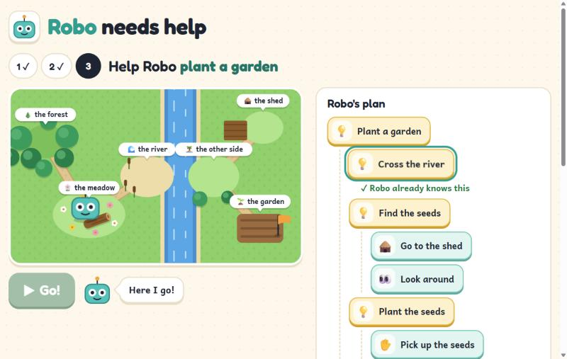

# Robo needs help

A small web game that teaches young children (ages 5 to 8) computational thinking by breaking big problems into small steps.

Robo is a friendly robot that only knows a few basic actions: move, pick up, put down and look. When a child gives Robo a big goal such as "cross the river", Robo answers "I don't know how to do that. What is it made of?" The child breaks the goal into smaller steps, and keeps breaking those down until every step is something Robo already knows. Then Robo acts it out, the child sees exactly where it goes wrong, and fixes it.

**▶ Play it: [cazsaragih.github.io/robo-needs-help](https://cazsaragih.github.io/robo-needs-help/)**



## The three levels

| Level | Goal | What it adds |
|---|---|---|
| 1 | Post the letter | Decomposition, gently: break the goal into two ideas ("find the letter", "carry the letter to the postbox"), and the ideas into actions. Introduces the pattern *find something, then carry it somewhere*. |
| 2 | Cross the river | The same pattern ("find a log", "carry the log to the river") with a twist: where the log is put down matters, because there it becomes a bridge. Three ideas, and a dead end ("build a boat"). |
| 3 | Plant a garden | The garden is across the same river. "Cross the river", taught in level 2, is now **one card**: Robo already knows it, so 7 of the 13 actions come for free. |

The progression is *learn a pattern → apply it with a twist → reuse a whole skill*: difficulty rises from level 1 to 2, and level 3 is bigger again but feels lighter because of what the child already taught. Levels unlock in order, so a child always reaches level 3 knowing how to cross the river. (The first version had the river first and the letter second, which made level 2 easier than level 1; swapping them fixed the dip.)

## What it teaches

- **Decomposition:** break a big problem down until you reach things you know for sure.
- **Abstraction:** a skill Robo has been taught is remembered and can be used as a single step later.
- **Pattern recognition:** later levels get easier when earlier skills are reused.
- **Algorithms and debugging:** order the steps, run them, find the step that fails and fix it.

Most coding games for children work bottom-up: you start with commands and assemble them toward a goal. This one works top-down: you start with the goal and decompose it. The program a child builds is a tree of skills, not a list of commands.

## Running it

```bash
npm install
npm run dev
```

| Command | What it does |
|---|---|
| `npm run dev` | Start the development server |
| `npm test` | Run all tests once |
| `npm run test:watch` | Re-run tests as files change |
| `npm run lint` | Check the code with oxlint |
| `npm run build` | Type-check and build for production |

## Architecture

The code is split into four layers. Each layer only depends on the ones above it in this list.

| Folder | Contents | Depends on React |
|---|---|---|
| `src/core/` | World model, skill book, and the runner that plays a skill against a world | No |
| `src/levels/` | The three levels, described as plain data | No |
| `src/components/` | Reusable UI parts: skill card, skill tree, map, Robo, speech bubble | Yes |
| `src/screens/` | `Game` (which level is open, which are solved, the shared skill book), `LevelScreen` (one level: building, running and watching the plan) and `Finale` | Yes |

In one sentence: the child's taps change a **skill book** through pure core functions; pressing **Go** runs the book against the level's **world** and returns every step at once; the screen then **plays those steps back** on the map and in the plan.

## Design decisions

### Learning design

- **Children pick steps from cards; they do not type.** The target age is 5 to 8, where many children cannot read or type fluently. Every card has an icon as well as a text label.
- **New skill names come from idea cards that each level provides.** Children this age can't type "find a log", so a level offers a few idea cards, including some that don't help. The child chooses which ideas a goal is made of, then breaks each idea down further. Choosing and rejecting ideas is the decomposition skill itself, and it keeps the game top-down rather than building up from commands.
- **Every idea card has a check: what must be true once it's done.** "Find a log" is done when Robo can see the log; "walk across" when Robo is on the other side. When Robo finishes an idea, it checks it, and if the check fails it stops right there and says what's missing ("I did "find a log", but I can't see the log."). Without this, idea names meant nothing: a child could put the whole solution inside "build a boat" and win, skipping decomposition. With it, each idea is a real sub-goal, much like a unit test for a skill, and mistakes are caught in the idea where they happen.
- **A run can end three ways:** solved; stuck (a step failed, or Robo met a skill it doesn't know); or *not there yet* (every step worked, but the goal wasn't reached). The last one matters for teaching: the plan runs, it just doesn't do what was needed, and Robo says so differently.
- **Skills learned in earlier levels are drawn folded:** one card with "✓ Robo already knows this", which lights up as a whole while Robo works through it on the map. The child sees their earlier work pay off without a wall of old steps, and can't accidentally edit a finished skill from inside another level.
- **Failures are codes, not sentences** (`pathBlocked`, `handsFull`, …). The core says what went wrong; the UI decides how to tell a five-year-old ("My hands are full!").

### Game logic (`src/core/`)

- **The core is pure TypeScript with no React.** It is deterministic and tested without rendering anything.
- **The world is a few named places joined by paths, not a grid.** A path can need an item to be in place before it opens (a log on the riverbank opens the way across). One rule covers bridges, keys and similar puzzles, and it keeps the problems everyday ones.
- **Actions never change the world they are given; they return a new one.** Every step of a run can be kept, compared and replayed, and tests need no setup or cleanup between steps. It is also what lets React notice changes: a new object means something changed.
- **Skills are stored in a skill book, not as a nested tree.** The book maps each skill's name to its steps, and a step is either a basic action or another skill used by name. Reusing "cross the river" in a later level is one reference, not a copy, and fixing a skill fixes it everywhere it is used. The tree the child sees is drawn by expanding names.
- **A skill missing from the book is how Robo asks "what is that made of?"** Running a skill Robo hasn't been taught stops with `unknownSkill`, so the same runner handles both decomposing and debugging. A skill that uses itself is reported as a `loop` instead of running forever.
- **A run returns every action performed, with the world after each one and its place in the tree.** The UI plays this list back at whatever speed it likes; the core knows nothing about animation.
- **Idea checks come in through a callback.** The runner only asks "was this skill done?"; the level supplies the answers. The core still knows nothing about levels.
- **A level is data:** a goal, a starting world, a target, a check per idea, a position for each place on the map, and the cards on offer. Level files are named after what they are (`postTheLetter.ts`, `crossTheRiver.ts`, `plantAGarden.ts`), and their order lives in one list in `levels/index.ts`, so reordering levels is a one-line change.

### UI architecture

- **Components take everything through props and know nothing about levels.** `SkillTree` is given a skill book, a goal and which steps to highlight; `SkillCard` is given one step. Either could be dropped into another product.
- **Data flows down, events flow up.** Components never change the skill book themselves. `SkillTree` reports "the child tapped this skill" or "remove step 1 of 'find a log'" through callback props; the screen decides what that means. A component given no callbacks draws no buttons, so the same tree works as a read-only view elsewhere.
- **One skill book for the whole game, held by `Game`.** Every level reads and changes the same book, so a skill taught in one level is still known in the next. Every change to it is a pure core function (`addStep`, `removeStep`), so the editing rules are tested without rendering anything.
- **Running a plan is computed once, then played back.** Pressing Go calls `playLevel`, which returns every step instantly. The screen then lights up one step at a time with a timer, and only at the end shows the failed card and what Robo says. The step delay is a prop, so tests run with no delay. The plan is locked while Robo runs, and any edit clears the last run's highlights so they never point at the wrong card.
- **A new React `key` per level** restarts the level screen when the child moves on (or starts over), so no run, highlight or chosen skill leaks from one level to the next, while the shared skill book, held above it, stays.
- **Words and icons live in the UI layer** (`cardText.ts`, `roboSpeech.ts`). The core says `{ kind: 'move', to: 'forest' }`; the UI says "Go to the forest" with a tree icon. Translation would attach there.
- **Each component has its own CSS Module**, so class names are scoped to the component and can't clash with a host product's styles. **One set of design tokens** (colours, radius and fonts as CSS custom properties in `index.css`) is shared by all of them, so the look can be changed in one place.

### Look, feel and accessibility

- **The world is a top-down map drawn in SVG and animated with CSS, not a game engine.** The whole map is always in view, so children can see which places connect before they plan. React re-renders the map from the world after each step; CSS transitions glide Robo and items to their new places, and short CSS animations show each action (a hop for walking, darting eyes and a ripple for looking, a squash for picking up).
- **The river comes from the level's rules, not from a drawing.** Levels only give each place an x and y position. Trails are drawn between connected places; a path that needs an item is drawn as a river across it, and that item lying in place is drawn as a bridge. Each place has a signpost with the same icon as its cards, so children who can't read can match cards to places.
- **Robo's head is Robo's icon everywhere:** the token on the map, the logo, and next to the speech bubble. One `RoboHead` component draws it.
- **Visual design follows research on young children's interfaces:** big, chunky targets that press down when tapped, so every tap gets visible feedback ([Nielsen Norman Group](https://www.nngroup.com/articles/children-ux-physical-development/)); "Go!" instead of "Run", since words like "submit" confuse 6–8-year-olds; and fewer choices at a glance, with the card tray split into *Ideas* and *Robo knows how to*.
- **Two bundled fonts.** [Andika](https://software.sil.org/andika/), designed by SIL for beginning readers (single-storey *a* and *g*, as in early-reading books), for everything children read; Fredoka, a rounded display font, only for the title and headings. Both are bundled with the app rather than loaded from Google Fonts, so a child's device never contacts a third-party server, in the spirit of [ScratchJr](https://www.media.mit.edu/publications/designing-scratchjr-support-for-early-childhood-learning-through-computer-programming/)'s rule of no internet links in the app.
- **Layout adapts to the screen.** On wide screens the map is pinned beside the plan. On phones only the Go bar is pinned, to the bottom of the screen, so the plan gets the space; pressing Go scrolls the map into view.
- **Accessibility is built into the components:**
  - Robo's speech bubble is a `role="status"` region, so each new sentence is read out by screen readers without moving focus.
  - The map has a text description ("Robo is at the forest. Robo is carrying the log.").
  - The step Robo is doing is marked `aria-current="step"`, and a failed step has text that screen readers read out, not just a red border.
  - Icons are hidden from screen readers, because the label already says the same thing.
  - Everything works with the keyboard, and every button is at least 44px for small fingers.
  - All motion switches off when the device asks for reduced motion.
- **A finish moment:** after the last level, a panel celebrates, shows how many skills the child taught Robo, and offers Start over, which asks once before forgetting everything.

### Engineering

- **TypeScript strict mode**, so missing cases and possible `null` values are caught at compile time. Unions are matched with `switch` statements that have no `default`, so adding a new kind of action or failure is a compile error until every place handles it.
- **Tests at three levels:** the core is tested directly (actions, the runner, idea checks, every level being solvable with its own cards); components are tested the way a user meets them, finding things by role and name with React Testing Library; and one test plays the whole game through the real UI, from level 1 to the finish panel.
- **CI on every push** runs lint, tests, type-check and build with GitHub Actions.
- **Every push to `main` that passes CI is published to GitHub Pages** by a deploy job that only runs after the checks succeed, so a broken build never goes live. Vite builds with relative paths, so the game works from the `/robo-needs-help/` folder without hard-coding it.

## How this was built

I built this with [Claude Code](https://claude.com/claude-code), Anthropic's AI coding tool, working as a pair programmer. That is why the commits carry a `Co-Authored-By: Claude` line; the model it names is the one I was using at the time (Claude Fable 5.2 for the first part, then Claude Opus 5.5).

How the work was split:

- **I set the direction:** the concept, the age group, the constraints (original work, no hardware, a small polished first version), and what to build next.
- **I made the design calls,** usually after Claude laid out the options and a recommendation. Some of them:
  - children pick from cards rather than type;
  - skills live in a skill book rather than a nested tree;
  - new skill names come from idea cards;
  - every idea gets a check;
  - a top-down map with the whole level in view, and Robo's head as its icon;
  - swapping levels 1 and 2 when the difficulty dipped;
  - dropping voice-over after trying it, because the browser's built-in voices didn't sound good enough for children.
- **Claude wrote most of the code and tests,** in small steps, explaining the TypeScript and React concepts as it went by comparing them to C# and Unity, which is my background.
- **Every step was checked:** lint, type-check and tests before each commit, CI on every push, and the game played in a real browser at desktop and phone sizes.

What I learned about working this way:

- **Asking "why?" found the real problems.** Running ten different plans against the river level showed that idea names meant nothing ("build a boat" could hold the whole solution), which led to idea checks. Asking why level 2 felt easier than level 1 led to swapping them.
- **The AI is fast, but not always right.** Some of its tests expected the wrong thing (a skill count of 11 instead of 10; a route straight from the meadow to the far bank, which the map doesn't allow). The failing tests caught it. Tests and playing the game, not the AI's confidence, decided what was correct.

## Tech

Vite, React 19, TypeScript, Vitest, React Testing Library, oxlint, Fontsource (Andika and Fredoka), GitHub Actions and GitHub Pages.
